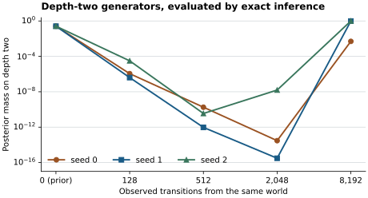

# Exact inference without listing every tree

In the 16-leaf synthetic experiment the posterior can be computed exactly, even though it ranges over 646,402,186 balanced labeled trees. The three depth-two generators illustrate why this check matters: at 512 transitions, the reference posterior put more than .993 on depth four in all three cases. Learning to sample this distribution accurately would not recover their generating depth.

| Generating depth | Seed | Posterior on depth 2 | Depth 3 | Depth 4 | Generating tree | Held-out mean log probability ↑ |
|---:|---:|---:|---:|---:|---:|---:|
| 2 | 0 | <.0001 | .0002 | .9998 | <2e-10 | −1.541 |
| 2 | 1 | <.0001 | .0065 | .9935 | <2e-10 | −1.363 |
| 2 | 2 | <.0001 | .0007 | .9993 | <2e-10 | −1.445 |
| 4 | 0 | <.0001 | .0003 | .9997 | .7966 | −2.182 |
| 4 | 1 | <.0001 | <.0001 | >.9999 | .0658 | −2.215 |
| 4 | 2 | .0001 | .9042 | .0957 | .0041 | −2.077 |

The benchmark and this evaluator use the same 512 training transitions, 512 held-out transitions and prior per seed. The depth-one posterior was below .0001 throughout. The model's prior over depths 1–4 is (.037, .260, .473, .230); it penalizes parameter count and node count rather than simply preferring shallow trees. Reweighting to a uniform depth prior still gives depth four the most posterior mass in the three depth-two cases at 512. The world's persistent parameter generator differs from the inference model's symmetric Dirichlet row prior.

**Why the sum is possible.** A subtree is identified by its leaf set and remaining depth. For each unordered balanced split of that set, its integrated node likelihood uses counts of transitions into the left or right child, grouped by whether the previous leaf was in the left child, right child or outside. Those counts depend on this split alone. Multiply its likelihood by the two subtree sums, then add over splits. At a bottom group use the integrated categorical likelihood for its atomic children. Divide the root sum for each depth by the number of structures at that depth and weight by its prior probability. Sampling these conditional splits gives exact posterior draws up to floating-point precision. For exact predictions, propagate split-weighted categorical probabilities from the root to the atomic leaves for each possible source leaf.

Subset construction took .90 s once; the normalizer took .50–2.02 s per history, the full 16×16 predictive matrix .48–2.80 s more and 256 exact draws .06–.18 s. These are wall times on a shared CPU host with one math-library thread. At fixed 16 leaves this is a practical exact baseline. The computation still grows combinatorially. An arbitrary RGM need not share this factorization.

**How much data?** A post hoc check used nested prefixes of the same three depth-two trajectories, with no changes to either generator or inference model. At 2,048 transitions all three posteriors still favored depth four. At 8,192 transitions two favored depth two (posterior .983 and above .9999) and the third still gave depth two only .005. The finite-data result does not establish that the generating depth can never be recovered. See `data_sensitivity.json` for every prefix, seed and reweighting.



**Checks and rerun.** On four and eight leaves the implementation matches exhaustive enumeration on the log normalizer, every terminal probability and each individual forecast. On 16 leaves it checks the generating tree's posterior from an independent full-tree likelihood against its probability along the conditional split path. The depth-two seed-0 rerun reproduced every non-timing field.

```sh
export OPENBLAS_NUM_THREADS=1 OMP_NUM_THREADS=1
python -m pytest -q experiments/hierarchy/subset_dp/test_inside.py
python -m experiments.hierarchy.subset_dp.benchmark --out /tmp/scaled-exact.json
python -m experiments.hierarchy.subset_dp.data_sensitivity --out /tmp/prefix-check.json
```

The same-family GFlowNet, particle, greedy and projected FSL measurements are in [the posterior experiment](../posterior/RESULTS.md). The online umbrella-controller readouts in [the RGM experiment](../bridge/RESULTS.md) use a different likelihood and candidate space.
